# Nora Language & Compiler Gap Assessment (Source-Verified)

This assessment was produced by auditing the actual Go compiler implementation (`pkg/`), core/standard libraries (`core/`, `std/`), and C11 runtime (`std/runtime/`) directly, bypassing `docs/`.

```mermaid
flowchart LR
    subgraph Frontend["1. Frontend (Lexer/Parser)"]
        L["pkg/lexer & pkg/parser"]
    end
    subgraph Middle["2. Semantic & Lease Solver"]
        S["pkg/semantic"]
        T["pkg/topology"]
    end
    subgraph Backend["3. Lowering & Codegen"]
        H["pkg/hir"]
        C["pkg/codegen"]
    end
    subgraph Runtime["4. Runtime & Stdlib"]
        R["std/runtime (C11)"]
        STD["core/ & std/ (.nr)"]
    end
    L -->|"Missing infix/postfix rules"| S
    S -->|"Incomplete monomorphization & type inference"| T
    T -->|"Missing CFG edges & defer/closure tracking"| H
    H -->|"Dual ASTExpr fallback split"| C
    C -->|"Drop/defer/select bugs"| R
    R -->|"Header/allocator & scheduler races"| STD
```

---

## Executive Summary: Priority Matrix

| Priority | Category | Key Gaps Identified |
| :--- | :--- | :--- |
| **P0 — Critical Soundness & Memory Safety** | Lease Solver, HIR/Codegen, Closures, Runtime | Closure capture double-free; `return` in `if`/`else` double `PreDrops` (UAF + double-free); `?` (`TryExpression`) skipping `defer` and drop flags; `defer` use-after-free; `for` loop missing from CFG (`pkg/topology/cfg.go`) & missing loop-move checks; `.rodata` string literal header out-of-bounds read (`ptr - 48`). |
| **P1 — Core Language & Type System** | Generics, Sum Types, Operators, Types | `cloneAndSubstituteHelper` missing 7 AST nodes (including `?` and `chan T`); `substituteType`/`matchType` missing `T[]`, `T[N]`, `chan T`; sum-type variant fields sorted alphabetically in patterns/constructors vs declaration order in C structs; missing tuples; non-exhaustive `match` on primitives/strings; broken `&^`, `&^=`, `===`, and `~` operators. |
| **P2 — HIR & Codegen Consolidation** | `pkg/hir` & `pkg/codegen` | ~40% of expressions bypass HIR via `hir.ASTExpr` fallback; split `spawn` implementation (`hir_codegen.go` ignores `scope` waitgroups, `expressions.go` ignores `MonitorChannel`); `for` over fixed-size `T[N]` or `Map[K,V]` or `Range` variable emits invalid C; `select` leaks unselected non-channel owned values. |
| **P3 — Runtime & Standard Library** | `std/runtime/`, `std/`, `core/` | `Vector` out-of-bounds prints and falls through to UB; `Vector.Clear` and `HashMap.Remove` leak owned elements/keys; `io.Scan(str)` segfaults on `.rodata`; zero UTF-8 support in `std/string`; `strconv`/`serialize` 32-bit `i32` limits; `context.Cancel` only wakes 1 fiber; `sync.Once` race condition; missing filesystem/path/process/buffered-IO modules. |
| **P4 — Tooling & Developer Experience** | CLI, Testing, LSP, Formatter | `nora init` generates non-compiling `io.println`; `nora test` hardcodes `pkg/cmd/test` (no user unit test runner); LSP package cache disabled & `Rename`/`References` limited to single active file; `nora lib add` ignores `@version` git checkout. |

---

## 1. P0: Critical Soundness, Lifetime & Memory-Safety Gaps

> [!CAUTION]
> These issues cause deterministic Use-After-Free (UAF), Double-Free, or silent `defer` bypasses in valid Nora programs and should be addressed first.

### 1.1. `return` Inside `if`/`else` Emits `PreDrops` Twice (Use-After-Free & Double-Free)
- **Location**: [`lowerStatementsWithDrops`](file:///E:/Project/Project%20Nora/nora/pkg/hir/lower.go#L1561-L1573) vs. [`lowerBlock`](file:///E:/Project/Project%20Nora/nora/pkg/hir/lower.go#L271-L280)
- **Root Cause**: `lowerBlock` skips emitting `PreDrops` before `*ast.ReturnStatement` (`if _, isRet := stmt.(*ast.ReturnStatement); !isRet`) because `case *ast.ReturnStatement:` ([`lower.go:478-492`](file:///E:/Project/Project%20Nora/nora/pkg/hir/lower.go#L478-L492)) evaluates the return value first and then emits `PreDrops`. However, `lowerStatementsWithDrops` (used for `if`/`else` blocks at [`lower.go:1403-1406`](file:///E:/Project/Project%20Nora/nora/pkg/hir/lower.go#L1403-L1406)) omits the `!isRet` guard.
- **Impact**: Any `return expr` inside an `if` or `else` block drops local variables **before** evaluating `expr` (Use-After-Free) and then drops them **a second time** inside `case *ast.ReturnStatement:` (Double-Free).

### 1.2. Capturing Owned Variables in Closures Causes Deterministic Double-Free
- **Location**: [`AnalyzeLambdaExpression`](file:///E:/Project/Project%20Nora/nora/pkg/semantic/analyzer.go#L4748-L4837), [`solver.go`](file:///E:/Project/Project%20Nora/nora/pkg/topology/solver.go#L798-L800), [`genLambdaExpression`](file:///E:/Project/Project%20Nora/nora/pkg/codegen/expressions.go#L1363-L1382), [`emitLambdaEnvDrops`](file:///E:/Project/Project%20Nora/nora/pkg/codegen/generator.go#L2898-L2915)
- **Root Cause**: `genLambdaExpression` shallow-copies captured variables into the closure environment (`_env_local->x = x;`), and `emitLambdaEnvDrops` frees every captured owned variable when the closure is dropped. However, neither semantic analysis nor the topological lease solver marks captured owned variables as moved in the enclosing function, so the enclosing function **also** drops `x` at scope exit.
- **Additional Closure Bug**: In [`AnalyzeLambdaExpression`](file:///E:/Project/Project%20Nora/nora/pkg/semantic/analyzer.go#L4820-L4829), the loop populating `fnType.ParamLeases` maps `#` to `types.LeaseWrite` (inverted!), ignores `&`, and fails to default owned parameter types to `types.LeaseMove`.

### 1.3. `TryExpression` (`?`) Bypasses `defer`, Dynamic Drop Flags, and Temp Flushing
- **Location**: [`genTryExpression`](file:///E:/Project/Project%20Nora/nora/pkg/codegen/expressions.go#L2868-L2937)
- **Root Cause**:
  1. When `?` takes the early-return path on `Err`/`None` ([`lines 2900-2929`](file:///E:/Project/Project%20Nora/nora/pkg/codegen/expressions.go#L2900-L2929)), it never emits `g.ActiveDefers` (or HIR `l.activeDefers`).
  2. It emits `TryDrops` unconditionally via `g.emitDrop` without checking `g.hasDropFlag(sym)` (`nr_df_...`), causing a double-free if a local variable was conditionally moved prior to `?`.
  3. It skips `nr_flush_temps()`.

### 1.4. Topological Lease Solver & CFG Miss `for` Loops, `defer`, `const`, and `MonitorChannel`
- **`for` Loops Missing from Control Flow Graph**:
  - In [`cfg.go:160-232`](file:///E:/Project/Project%20Nora/nora/pkg/topology/cfg.go#L160-L232), `buildStatement` handles `WhileStatement` but has **no case for `*ast.ForStatement`**, treating it as a flat `BlockSimple` with no loop back-edge. `break`/`continue` inside a `for` loop wire to an outer `while` or `exitNode`, and Non-Lexical Lifetimes ([`liveness.go`](file:///E:/Project/Project%20Nora/nora/pkg/topology/liveness.go#L18-L62)) fails to propagate liveness across `for` iterations.
  - Similarly, [`solver.go:998-1055`](file:///E:/Project/Project%20Nora/nora/pkg/topology/solver.go#L998-L1055) never calls `s.checkLoopMoves` on `*ast.ForStatement` (unlike `WhileStatement` at [`line 994`](file:///E:/Project/Project%20Nora/nora/pkg/topology/solver.go#L994)), allowing an outer owned variable to be moved repeatedly across `for` loop iterations.
- **`IfExpression` / `MatchExpression` in Assignments Missing from CFG**:
  - [`cfg.go:216-225`](file:///E:/Project/Project%20Nora/nora/pkg/topology/cfg.go#L216-L225) only builds CFG branches when `IfExpression` or `MatchExpression` appears directly inside `*ast.ExpressionStatement`, missing `var x = if ...` and `x = match ...`.
- **`DeferStatement` Untracked by Lease Solver**:
  - [`solver.go`](file:///E:/Project/Project%20Nora/nora/pkg/topology/solver.go#L500-L1150) has no `case *ast.DeferStatement:`. A variable borrowed inside `defer cleanup(#x)` is not pinned to the end of the function scope and gets dropped right after its last non-deferred lexical usage (Use-After-Free when `defer` runs).
- **`ast.Inspect` Omits `ConstStatement` and `SpawnExpression.MonitorChannel`**:
  - [`walk.go:20-344`](file:///E:/Project/Project%20Nora/nora/pkg/parser/ast/walk.go#L20-L344) has no case for `*ast.ConstStatement`, and [`walk.go:175-182`](file:///E:/Project/Project%20Nora/nora/pkg/parser/ast/walk.go#L175-L182) omits `n.MonitorChannel` in `*ast.SpawnExpression`, causing the lease solver to drop `mon_ch` before `spawn(mon_ch) worker()`.

### 1.5. C Runtime Reads 48 Bytes Before `.rodata` String Literals
- **Location**: [`memory.c:62-64`](file:///E:/Project/Project%20Nora/nora/std/runtime/memory.c#L62-L64), [`string.c:24-25, 72-75`](file:///E:/Project/Project%20Nora/nora/std/runtime/string.c#L24-L25)
- **Root Cause**: Static C string literals (`"hello"`) do not have an `nr_header_t` prefix, yet `nr_free`, `nr_str_free`, and `nr_claim_str` compute `(nr_header_t*)((char*)ptr - NR_HEADER_SIZE)` and dereference `h->magic` 48 bytes before `ptr`. If a string literal sits within the first 48 bytes of a read-only memory page, this segfaults.

---

## 2. P1: Core Language, Syntax & Type System Gaps

### 2.1. Incomplete Generics & Monomorphization (`pkg/semantic/analyzer.go`)
1. **`cloneAndSubstituteHelper` Omits 7 AST Node Types ([`analyzer.go:6966-7339`](file:///E:/Project/Project%20Nora/nora/pkg/semantic/analyzer.go#L6966-L7339))**:
   - `*ast.TryExpression` (`?`), `*ast.ConstStatement`, `*ast.SelectStatement`, `*ast.RangeExpression`, `*ast.SliceExpression`, `*ast.PinStatement`, and `*ast.ChanType` hit `default: return n`, sharing the exact same AST pointer across all generic instantiations. Because `TryDrops[tryExpr]` ([`solver.go:478`](file:///E:/Project/Project%20Nora/nora/pkg/topology/solver.go#L478)) and `SemanticInfo.Types[tryExpr]` are keyed by AST node pointer, using `?` inside a generic function corrupts types and drops across monomorphizations.
2. **`substituteType` & `hasGeneric` Omit `ChanType` and `ArrayType` ([`analyzer.go:5912-6065`](file:///E:/Project/Project%20Nora/nora/pkg/semantic/analyzer.go#L5912-L6065), [`8233-8282`](file:///E:/Project/Project%20Nora/nora/pkg/semantic/analyzer.go#L8233-L8282))**:
   - Generic channels (`chan T`) and fixed-size arrays (`T[N]`) inside generic structs, enums, or function signatures are never substituted with concrete types.
3. **Generic Call Type Inference (`matchType`) Fails on `T[]`, `T[N]`, `chan T`, and `ProtocolType[T]` ([`analyzer.go:7574-7661`](file:///E:/Project/Project%20Nora/nora/pkg/semantic/analyzer.go#L7574-L7661))**:
   - `T[]` parses as `IndexExpression{Left: Identifier("T"), Indices: []}`, whereas `matchType` ([`line 7621`](file:///E:/Project/Project%20Nora/nora/pkg/semantic/analyzer.go#L7621)) checks `patternBaseType.Name() == "List" && len(pt.Indices) == 1`. Thus, calling `fn foo[T](xs: T[])` without explicit `[T]` always fails to infer `T`.

### 2.2. Sum Types & Pattern Matching (`match`)
1. **Alphabetical vs. Declaration Order Mismatch in Multi-Field Enum Variants**:
   - [`TypeStatement`](file:///E:/Project/Project%20Nora/nora/pkg/semantic/analyzer.go#L2235-L2257), HIR [`VariantConstructor`](file:///E:/Project/Project%20Nora/nora/pkg/hir/lower.go#L932), and C struct generation ([`codegen/types.go:404`](file:///E:/Project/Project%20Nora/nora/pkg/codegen/types.go#L404)) use `variant.FieldNames` (declaration order).
   - However, [`analyzePattern`](file:///E:/Project/Project%20Nora/nora/pkg/semantic/analyzer.go#L1110) and selector constructors ([`analyzer.go:4437`](file:///E:/Project/Project%20Nora/nora/pkg/semantic/analyzer.go#L4437)) call `sa.sortedFieldNames(variant.Fields)` (alphabetical order!). Any multi-field variant whose field names are not in alphabetical order (e.g. `Pair(z: i32, a: str)`) mismatches field types during construction and destructuring.
2. **Missing Exhaustiveness Check on Non-Sum Types ([`analyzer.go:2585-2633`](file:///E:/Project/Project%20Nora/nora/pkg/semantic/analyzer.go#L2585-L2633))**:
   - `match` on `i32`, `bool`, `str`, or `struct` does not require a wildcard `_` branch, even when used as a value expression (leaving the C result variable uninitialized if no arm matches).
3. **Missing Pattern Features**:
   - No pattern guards (`Pattern if cond => ...`), no struct/array destructuring in `match`, and no nested pattern destructuring (`Some(Ok(x)) => ...`).

### 2.3. Interfaces / Protocols Ignore Lease Compatibility
- **Location**: [`implements`](file:///E:/Project/Project%20Nora/nora/pkg/semantic/analyzer.go#L7341-L7470) & [`resolveTypeNode`](file:///E:/Project/Project%20Nora/nora/pkg/semantic/analyzer.go#L5468-L5472)
- **Gap**: `sa.implements` checks parameter types and return types, but ignores `ReceiverLease` and `ParamLeases`. A method taking a consuming `@Self` or mutable `&Self` receiver is allowed to satisfy an interface expecting a read-only `#Self` receiver.

### 2.4. Broken Operators & Literal Edge Cases
- **Bit-Clear (`&^` and `&^=`)**:
  - `&^=` (`token.AND_NOT_ASSIGN`) is missing from `precedences` and `registerInfix` in [`parser.go:38-64, 184-195`](file:///E:/Project/Project%20Nora/nora/pkg/parser/parser.go#L184-L195) and cannot be parsed.
  - `&^` is omitted from [`analyzer.go:1436`](file:///E:/Project/Project%20Nora/nora/pkg/semantic/analyzer.go#L1436) (`"unknown operator: &^"`) and emitted verbatim as `&^` into C11 ([`hir_codegen.go:1193`](file:///E:/Project/Project%20Nora/nora/pkg/codegen/hir_codegen.go#L1193), invalid C syntax instead of `& ~`).
- **Strict Identity (`===`)**:
  - Lexed and parsed, but rejected by [`analyzer.go:1664`](file:///E:/Project/Project%20Nora/nora/pkg/semantic/analyzer.go#L1664) and emitted verbatim as `===` into C11.
- **Bitwise NOT (`~`)**:
  - Restricted in [`analyzer.go:1879-1886`](file:///E:/Project/Project%20Nora/nora/pkg/semantic/analyzer.go#L1879-L1886) to only `i32` and `int` (rejects `u8`, `u16`, `u32`, `u64`, `i8`, `i16`, `i64`, `uint`, `byte`).
- **Increment/Decrement (`++`/`--`)**:
  - Only parsed on bare identifiers in [`parser.go:771-798`](file:///E:/Project/Project%20Nora/nora/pkg/parser/parser.go#L771-L798); `arr[i]++` and `obj.field++` fail to parse.
- **Array/Slice Indexing & `len()`**:
  - [`isIntegerType`](file:///E:/Project/Project%20Nora/nora/pkg/semantic/analyzer.go#L7915-L7921) rejects `i16`, `u8`, `u16`, `u32`, `uint`, `isize`, `usize` as array indices.
  - [`len()`](file:///E:/Project/Project%20Nora/nora/pkg/semantic/analyzer.go#L3714-L3740) rejects fixed-size arrays `T[N]` (`*types.ArrayType`) and `Map[K, V]`.
  - Slicing (`arr[a:b]`) in [`analyzer.go:3403-3427`](file:///E:/Project/Project%20Nora/nora/pkg/semantic/analyzer.go#L3403-L3427) rejects fixed-size arrays `T[N]`.
- **Missing Tuples & Stubbed Imaginary Literals**:
  - No tuple type or syntax exists anywhere in the language (forcing boilerplate structs for multi-value returns).
  - `*ast.ImaginaryLiteral` (`5.0i`) is typed as `f64` ([`analyzer.go:2362`](file:///E:/Project/Project%20Nora/nora/pkg/semantic/analyzer.go#L2362)) and emitted as `5.0` after stripping `i` ([`expressions.go:63-68`](file:///E:/Project/Project%20Nora/nora/pkg/codegen/expressions.go#L63-L68)).

---

## 3. P2: HIR Lowering & C11 Codegen Architecture Gaps

### 3.1. Dual HIR / Legacy AST Codegen Split (`hir.ASTExpr`)
- **Location**: [`lower.go:1507-1510`](file:///E:/Project/Project%20Nora/nora/pkg/hir/lower.go#L1507-L1510), [`hir_codegen.go:1198-1199`](file:///E:/Project/Project%20Nora/nora/pkg/codegen/hir_codegen.go#L1198-L1199)
- **Gap**: `lowerExpression` falls back to wrapping unlowered AST nodes inside `&hir.ASTExpr{ASTNode: expr}`, which calls back into legacy `g.exprToString` / `g.genStatement`. Major constructs bypassing HIR include:
  - `MatchExpression`, `ScopeExpression`, `ParallelExpression`
  - `StructLiteral`, `ArrayLiteral`, `MapLiteral`, `IndexExpression` (all standard array/slice/map indexing), `RangeExpression`
  - `LambdaExpression` (leaving `hir.Lambda` in `hir_codegen.go:1541` completely dead code), `TryExpression`, `InterpolatedString`
  - Built-in calls (`len`, `panic`, `make`, `append`, `chan.clone`, macros)
- **Consequence — Broken `spawn` Inside `scope { ... }`**:
  - Top-level `spawn` is lowered to `hir.Spawn` ([`hir_codegen.go:1325-1521`](file:///E:/Project/Project%20Nora/nora/pkg/codegen/hir_codegen.go#L1325-L1521)), which supports `MonitorChannel` but **ignores `g.ScopeWaitgroups`**.
  - Inside `scope { ... }` (which uses `ASTExpr` -> `genSpawnExpression` at [`expressions.go:2165-2407`](file:///E:/Project/Project%20Nora/nora/pkg/codegen/expressions.go#L2165-L2407)), `g.ScopeWaitgroups` is supported, but **`MonitorChannel` and HIR `activeDefers`/`collectAllocas` are ignored**!
  - Furthermore, `sa.inScope` in [`analyzer.go:4134-4137`](file:///E:/Project/Project%20Nora/nora/pkg/semantic/analyzer.go#L4134-L4137) is incremented/decremented but never read anywhere, so `spawn` inside `scope { ... }` still rejects borrowing `#T` variables from the enclosing stack frame.

### 3.2. Broken `for` Loops Over Fixed-Size Arrays (`T[N]`), `Map[K, V]`, and `Range` Variables
- **Fixed-Size Arrays (`T[N]`)**: Emitted as value structs `typedef struct { T data[N]; } nr_arr_T_N;` ([`codegen/types.go:61-66`](file:///E:/Project/Project%20Nora/nora/pkg/codegen/types.go#L61-L66)), but [`lower.go:657-664`](file:///E:/Project/Project%20Nora/nora/pkg/hir/lower.go#L657-L664) and [`statements.go:552-583`](file:///E:/Project/Project%20Nora/nora/pkg/codegen/statements.go#L552-L583) pass the struct by value to `array_count(void*)` and cast it to `((T*)arrTemp)[idx]`, failing C compilation.
- **Built-in `Map[K, V]`**: Allowed in `for k, v in m` by [`analyzer.go:4566-4568`](file:///E:/Project/Project%20Nora/nora/pkg/semantic/analyzer.go#L4566-L4568), but unhandled in both `lower.go` and `statements.go` (falling through to `array_count(m)`).
- **`Range` Variable in HIR**: `var r = 0..10; for i in r` is handled in legacy [`statements.go:529`](file:///E:/Project/Project%20Nora/nora/pkg/codegen/statements.go#L529) but omitted in [`lower.go:504-664`](file:///E:/Project/Project%20Nora/nora/pkg/hir/lower.go#L504-L664) unless `s.NextCall != nil`.

### 3.3. `select` Unselected Send Case Leaks Owned Values in HIR Codegen
- **Location**: [`hir_codegen.go:356-361`](file:///E:/Project/Project%20Nora/nora/pkg/codegen/hir_codegen.go#L356-L361) vs. [`statements.go:1287-1298`](file:///E:/Project/Project%20Nora/nora/pkg/codegen/statements.go#L1287-L1298)
- **Gap**: When a `select` statement evaluates send payloads and another case wins, `hir_codegen.go` only frees unselected payloads if their type is `*types.ChanType`, leaking strings, structs, lists, maps, and closures.

### 3.4. Lambda C Symbol Hash Mismatch in Shared Pointer-Erased Functions
- **Location**: [`lower.go:1763-1773`](file:///E:/Project/Project%20Nora/nora/pkg/hir/lower.go#L1763-L1773) vs. [`expressions.go:1335-1342`](file:///E:/Project/Project%20Nora/nora/pkg/codegen/expressions.go#L1335-L1342) and [`hir_codegen.go:51-59`](file:///E:/Project/Project%20Nora/nora/pkg/codegen/hir_codegen.go#L51-L59)
- **Gap**: During HIR lowering, `lowerLambdaFunction` hashes `l.CurrentFunc.Name` (the concrete monomorphized name). When `genHIRFunctionWithName` emits a shared pointer-erased function (`overrideName` ending in `_ptr`), it replaces `g.CurrentFunc.Name` with `overrideName`, causing `genLambdaExpression` to compute a **different hash** than the emitted C function definition.

---

## 4. P3: C11 Runtime & Standard Library Gaps (`std/`, `core/`, `std/runtime/`)

### 4.1. C11 Runtime (`std/runtime/`)
1. **Debug Memory Accounting Corruption (`g_total_allocations`)**:
   - [`nr_str_concat`](file:///E:/Project/Project%20Nora/nora/std/runtime/string.c#L10-L14), [`nr_str_from_cstring`](file:///E:/Project/Project%20Nora/nora/std/runtime/string.c#L32-L36), [`nr_strdup`](file:///E:/Project/Project%20Nora/nora/std/runtime/string.c#L83-L87), and [`string_slice`](file:///E:/Project/Project%20Nora/nora/std/runtime/collection.c#L230-L235) allocate `len + 1` bytes via `nr_malloc` (adding `len + 1` to `g_total_allocations`), then overwrite `h->elem_size = 1; h->count = len` (or `h->elem_size = len`). When [`nr_free`](file:///E:/Project/Project%20Nora/nora/std/runtime/memory.c#L78-L80) runs, it subtracts `len` instead of `len + 1`, leaving 1 phantom leaked byte per freed string.
   - [`nr_net_recv`](file:///E:/Project/Project%20Nora/nora/std/runtime/net.c#L491-L497) and [`nr_net_udp_recvfrom`](file:///E:/Project/Project%20Nora/nora/std/runtime/net.c#L653-L665) allocate `max_len` bytes, then set `h->count = n` (bytes read), leaving `max_len - n` phantom leaked bytes in `g_total_allocations`.
2. **Fiber Scheduler & Concurrency Bugs ([`fiber.c`](file:///E:/Project/Project%20Nora/nora/std/runtime/fiber.c), [`runtime.h`](file:///E:/Project/Project%20Nora/nora/std/runtime/runtime.h), [`collection.c`](file:///E:/Project/Project%20Nora/nora/std/runtime/collection.c))**:
   - **`panic()` in Unscoped Fiber Segfaults**: [`nr_panic`](file:///E:/Project/Project%20Nora/nora/std/runtime/collection.c#L323-L337) calls `longjmp(self->panic_buf, 1)` whenever `self != g_main_fiber_info`, but `fiber_wrapper` ([`fiber.c:680-693`](file:///E:/Project/Project%20Nora/nora/std/runtime/fiber.c#L680-L693)) never calls `setjmp(self->panic_buf)`.
   - **16-Byte Infrastructure Leaks**: `scheduler_cleanup()` ([`fiber.c:572-611, 1654-1695`](file:///E:/Project/Project%20Nora/nora/std/runtime/fiber.c#L572-L611)) never drains remaining 16-byte `fiber_node_t` nodes in `g_queue`/`g_pinned_queues`, and [`channel_destroy`](file:///E:/Project/Project%20Nora/nora/std/runtime/channel.c#L276-L282) never drains remaining 16-byte `waiter_node_t` nodes in `c->senders`/`c->receivers`.
   - **Silent Fiber Drop on Deque Overflow**: [`deque_push`](file:///E:/Project/Project%20Nora/nora/std/runtime/fiber.c#L178-L188) silently returns if `b - t >= DEQUE_CAPACITY` instead of pushing to `g_queue`.
   - **`NR_COOPERATIVE_YIELD_CHECKPOINT` Overhead**: [`runtime.h:199-211`](file:///E:/Project/Project%20Nora/nora/std/runtime/runtime.h#L199-L211) never checks `g_active_fibers`, running yield checkpoints every 1000 function calls even in single-fiber programs.
3. **Async Networking Bugs ([`net.c`](file:///E:/Project/Project%20Nora/nora/std/runtime/net.c))**:
   - **Windows IOCP Use-After-Free**: [`nr_net_close`](file:///E:/Project/Project%20Nora/nora/std/runtime/net.c#L583-L586) frees the `nr_net_waiter_t` (containing `OVERLAPPED`) *before* `closesocket(s)` cancels pending I/O, so `nr_net_poller_thread` ([`line 123`](file:///E:/Project/Project%20Nora/nora/std/runtime/net.c#L123)) dereferences freed memory when the cancellation packet arrives.
   - **Linux `epoll` Concurrent Read/Write Overwrite**: [`net.c:476-479, 556-559`](file:///E:/Project/Project%20Nora/nora/std/runtime/net.c#L476-L479) stores a single `ev.data.ptr = waiter` per socket FD; concurrent read + write fibers on the same TCP socket overwrite each other's waiter and hang forever.

### 4.2. Standard Library (`std/` and `core/`)
1. **`std/collections`**:
   - **Out-of-Bounds Fallthrough in `Vector[T]` ([`vector.nr:54-109`](file:///E:/Project/Project%20Nora/nora/std/collections/vector.nr#L54-L109))**: `Get`, `GetMut`, `Pop`, `Remove`, and `Insert` print `"Error: Index out of bounds..."` and **do not `panic` or `return`**, falling straight through to `v.data.unchecked_get(index)` (out-of-bounds memory access).
   - **Memory Leaks**: [`Vector.Clear`](file:///E:/Project/Project%20Nora/nora/std/collections/vector.nr#L130-L132) sets `v.size = 0` without dropping owned elements; [`Vector.Set`](file:///E:/Project/Project%20Nora/nora/std/collections/vector.nr#L81-L85) overwrites `v.data[index]` without dropping the old value; [`HashMap.Remove`](file:///E:/Project/Project%20Nora/nora/std/collections/map.nr#L204-L210) sets `deleted = true` without dropping `key` and never rehashes tombstones.
   - **Duplicate/Incompatible `Iterator[T]` Interfaces**: [`core/iter/iter.nr:5`](file:///E:/Project/Project%20Nora/nora/core/iter/iter.nr#L5) defines `Iterator[T]` with `fn Next() Option[T]`, whereas [`std/collections/iterator.nr:4`](file:///E:/Project/Project%20Nora/nora/std/collections/iterator.nr#L4) defines `Iterator[T]` with value receiver `fn (self: Iterator[T]) Next() Option[#T]`.
2. **`std/io`**:
   - **Crash in `io.Scan(str)` ([`std/io/macro/main.go:218`](file:///E:/Project/Project%20Nora/nora/std/io/macro/main.go#L218))**: Generates `scanf("%s", s)` writing directly into `s` (which by default points to `""` in `.rodata`), causing an immediate segmentation fault.
   - **4 KB Fixed Buffers & 32-Bit File Offsets ([`std/io/io.nr:101-112, 245-315`](file:///E:/Project/Project%20Nora/nora/std/io/io.nr#L101-L112))**: `ReadLine`/`Scanner` silently truncate at 4095 bytes; `ReadFile` opens in `"r"` instead of `"rb"` mode and uses 32-bit `i32` sizes.
3. **`std/string` & `std/strconv` & `std/json`**:
   - **ASCII-Only Strings ([`std/string/string.nr`](file:///E:/Project/Project%20Nora/nora/std/string/string.nr))**: Zero UTF-8 codepoint iteration (`Reverse` corrupts multi-byte UTF-8; `Substring` slices mid-codepoint).
   - **32-Bit Integer Limit in `strconv` & `serialize`**: [`std/strconv/strconv.nr`](file:///E:/Project/Project%20Nora/nora/std/strconv/strconv.nr#L15-L172) only supports `i32` (and rejects `INT32_MIN`), and [`nr_serialize_json_i64`](file:///E:/Project/Project%20Nora/nora/std/serialize/serialize.nr#L36-L38) casts `i64` to `i32(val)`, truncating 64-bit integers in JSON!
4. **`std/sync`, `std/context`, `std/nursery`, `std/net`**:
   - **[`sync.Once.Do`](file:///E:/Project/Project%20Nora/nora/std/sync/sync.nr#L150-L158)**: Uses a 2-state atomic (`0`/`1`) instead of 3 states (`0=unrun, 1=running, 2=done`), so concurrent callers return before `f()` finishes executing.
   - **[`context.Cancel`](file:///E:/Project/Project%20Nora/nora/std/context/context.nr#L15-L30)**: Pushes a single `true` into a `chan[bool]` of capacity 1; if multiple fibers wait on `<-ctx.Done()`, only one fiber wakes up.
   - **[`UDPSocket.RecvFrom`](file:///E:/Project/Project%20Nora/nora/std/net/net.nr#L218)**: Passes `out_port` by value (`0`) to an `extern fn` expecting `&i32` (`int*`), causing a null-pointer dereference in C when a UDP packet arrives.
   - **[`http.Get`](file:///E:/Project/Project%20Nora/nora/std/net/http/http.nr#L249-L258)**: Takes `(host: #str, port: i32)` with no URL path parameter (hardcodes `path: "/"`).
5. **Missing Standard Library Modules**:
   - No `std/fs` or `std/path` (directory walking, `Mkdir`, `Remove`, `Stat`, `Rename`, path join/split).
   - No `std/os/exec` (spawning child processes) or `std/os/signal`.
   - No `std/testing` / `std/assert` for user-written unit tests and benchmarks.

---

## 5. P4: Compiler Tooling & Developer Experience Gaps

1. **`nora init` Emits Broken Code ([`pkg/cmd/nora/main.go:900, 922, 990`](file:///E:/Project/Project%20Nora/nora/pkg/cmd/nora/main.go#L900))**:
   - Generates `io.println(...)` instead of `io.PrintLn(...)`, so newly initialized projects fail to compile out of the box.
2. **`nora test` Hardcodes Compiler Integration Tests ([`pkg/cmd/nora/main.go:2809-2810`](file:///E:/Project/Project%20Nora/nora/pkg/cmd/nora/main.go#L2809-L2810))**:
   - Ignores CLI arguments and always runs `pkg/cmd/test`. User projects cannot run `nora test` on their own test files.
3. **LSP Performance & Cross-File Analysis ([`pkg/lsp/handler.go`](file:///E:/Project/Project%20Nora/nora/pkg/lsp/handler.go))**:
   - Package caching in `FileImportResolver.ResolvePackage` ([`lines 2818-2949`](file:///E:/Project/Project%20Nora/nora/pkg/lsp/handler.go#L2818-L2949)) is commented out, re-parsing all `std/` imports on every keystroke.
   - `Find References` and `Rename` ([`lines 289-292, 1303-1519`](file:///E:/Project/Project%20Nora/nora/pkg/lsp/handler.go#L289-L292)) only analyze the currently open file, missing references across other files in the package.
   - Member dot-completion ([`line 575`](file:///E:/Project/Project%20Nora/nora/pkg/lsp/handler.go#L575)) only triggers when the line ends with `.` (`strings.HasSuffix(prefix, ".")`), breaking as soon as the user types the first character of a method/field name.
   - Hover/SignatureHelp ([`lines 1071, 1776`](file:///E:/Project/Project%20Nora/nora/pkg/lsp/handler.go#L1071)) labels `LeaseWrite` as `#` instead of `&`.
4. **Incremental Build Cache Bug ([`pkg/cmd/nora/main.go:1884, 1934-1971`](file:///E:/Project/Project%20Nora/nora/pkg/cmd/nora/main.go#L1934-L1971))**:
   - `packageDeps` stores import paths (`"std/io"`) while `packageFiles` is keyed by package name (`"io"`), so dependency hash propagation misses changes in imported packages.

---

## 6. Verified Reproduction Test Suite (`pkg/cmd/test/repro_gap_*`)

All 30 core compiler, runtime, and standard library gaps have been reproduced with dedicated integration tests under `pkg/cmd/test/` and verified via `go test -v ./pkg/cmd/nora -run "TestCompilerWithTestFolder/.*repro_gap_"`:

| # | Test File | Gap Reproduced | Observed Failure Mode |
| :- | :--- | :--- | :--- |
| 01 | [repro_gap_01_if_return_double_predrop.nr](file:///E:/Project/Project%20Nora/nora/pkg/cmd/test/repro_gap_01_if_return_double_predrop/repro_gap_01_if_return_double_predrop.nr) | `return` in `if`/`else` emits `PreDrops` before evaluating return expression and emits `PreDrops` twice | Runtime Error: `r` dropped before return expression evaluated (`v = -1`) |
| 02 | [repro_gap_02_closure_capture_owned_double_free.nr](file:///E:/Project/Project%20Nora/nora/pkg/cmd/test/repro_gap_02_closure_capture_owned_double_free/repro_gap_02_closure_capture_owned_double_free.nr) | Closure capturing owned variable drops it in both closure env and outer scope | Runtime Error: `Box` dropped 3 times instead of 1 |
| 03 | [repro_gap_03_lambda_param_lease_inversion.nr](file:///E:/Project/Project%20Nora/nora/pkg/cmd/test/repro_gap_03_lambda_param_lease_inversion/repro_gap_03_lambda_param_lease_inversion.nr) | `AnalyzeLambdaExpression` maps `#` parameter to `LeaseWrite` (`char**`) instead of `LeaseRead` | Clang Error: `incompatible pointer types passing 'char *' to parameter of type 'char **'` |
| 04 | [repro_gap_04_try_skips_defer.nr](file:///E:/Project/Project%20Nora/nora/pkg/cmd/test/repro_gap_04_try_skips_defer/repro_gap_04_try_skips_defer.nr) | `TryExpression` (`?`) early return skips `defer` statements | Runtime Error: `defer was skipped on ? early return (g_defer_ran = 0)` |
| 05 | [repro_gap_05_try_skips_drop_flag.nr](file:///E:/Project/Project%20Nora/nora/pkg/cmd/test/repro_gap_05_try_skips_drop_flag/repro_gap_05_try_skips_drop_flag.nr) | `TryExpression` (`?`) early return ignores dynamic drop flags (`nr_df_...`) | Runtime Error: Conditionally moved `Item` dropped 2 times instead of 1 |
| 06 | [repro_gap_06_select_branch_move_double_free.nr](file:///E:/Project/Project%20Nora/nora/pkg/cmd/test/repro_gap_06_select_branch_move_double_free/repro_gap_06_select_branch_move_double_free.nr) | `SelectStatement` missing from `solver.go` and `cfg.go` | Topology Error: False `use of moved value 'tok'` on single move inside `select` |
| 07 | [repro_gap_07_defer_borrow_premature_drop.nr](file:///E:/Project/Project%20Nora/nora/pkg/cmd/test/repro_gap_07_defer_borrow_premature_drop/repro_gap_07_defer_borrow_premature_drop.nr) | `DeferStatement` untracked by lease solver, dropping borrowed variable before `defer` runs | Runtime Error: `Guard was already dropped before defer executed!` |
| 08 | [repro_gap_08_spawn_monitor_channel_walk.nr](file:///E:/Project/Project%20Nora/nora/pkg/cmd/test/repro_gap_08_spawn_monitor_channel_walk/repro_gap_08_spawn_monitor_channel_walk.nr) | `ast.Inspect` omits `SpawnExpression.MonitorChannel`, premature drop/move of `mon_ch` | Runtime Error: `FATAL: Deadlock detected!` on `<-mon_ch` |
| 09 | [repro_gap_09_generic_try_monomorph_collision.nr](file:///E:/Project/Project%20Nora/nora/pkg/cmd/test/repro_gap_09_generic_try_monomorph_collision/repro_gap_09_generic_try_monomorph_collision.nr) | `cloneAndSubstituteHelper` omits `*ast.TryExpression` (`?`) | Semantic Error: `type mismatch: expected i32, got T` |
| 10 | [repro_gap_10_generic_chan_and_range_clone.nr](file:///E:/Project/Project%20Nora/nora/pkg/cmd/test/repro_gap_10_generic_chan_and_range_clone/repro_gap_10_generic_chan_and_range_clone.nr) | `cloneAndSubstituteHelper` omits `*ast.ChanType` | Semantic Error: `type mismatch: channel expects 'T', got 'i32'` |
| 11 | [repro_gap_11_generic_struct_chan_field.nr](file:///E:/Project/Project%20Nora/nora/pkg/cmd/test/repro_gap_11_generic_struct_chan_field/repro_gap_11_generic_struct_chan_field.nr) | `substituteType` and `hasGeneric` omit `*types.ChanType` | Semantic Error: `type mismatch: expected chan[T], got chan[i32]` |
| 12 | [repro_gap_12_generic_slice_type_inference.nr](file:///E:/Project/Project%20Nora/nora/pkg/cmd/test/repro_gap_12_generic_slice_type_inference/repro_gap_12_generic_slice_type_inference.nr) | `matchType` fails to infer type parameter `T` from slice/list parameter `#T[]` | Semantic Error: `undefined type: 'T'` |
| 13 | [repro_gap_13_sumtype_variant_field_order.nr](file:///E:/Project/Project%20Nora/nora/pkg/cmd/test/repro_gap_13_sumtype_variant_field_order/repro_gap_13_sumtype_variant_field_order.nr) | Multi-field enum variants sort fields alphabetically (`sortedFieldNames`) instead of declaration order | Semantic Error: `type mismatch: expected str, got i32` |
| 14 | [fail_repro_gap_14_match_non_exhaustive_primitive.nr](file:///E:/Project/Project%20Nora/nora/pkg/cmd/test/repro_gap_14_match_non_exhaustive_primitive/fail_repro_gap_14_match_non_exhaustive_primitive.nr) | Non-exhaustive `match` on `i32` without `_` wildcard is accepted | Expected compilation to fail, but succeeded |
| 15 | [repro_gap_15_interface_lease_mismatch.nr](file:///E:/Project/Project%20Nora/nora/pkg/cmd/test/repro_gap_15_interface_lease_mismatch/repro_gap_15_interface_lease_mismatch.nr) | Interface coercion/satisfaction lease tracking mismatch | Topology Error: `cannot move out of 'c' while borrowed by 'r'` |
| 16 | [repro_gap_16_operator_bitclear.nr](file:///E:/Project/Project%20Nora/nora/pkg/cmd/test/repro_gap_16_operator_bitclear/repro_gap_16_operator_bitclear.nr) | Bit-clear `&^` and `&^=` unparsed / rejected by semantic analyzer / invalid C11 | Parser Error: `no prefix parse function for &^= found` |
| 17 | [repro_gap_17_operator_bitnot_non_i32.nr](file:///E:/Project/Project%20Nora/nora/pkg/cmd/test/repro_gap_17_operator_bitnot_non_i32/repro_gap_17_operator_bitnot_non_i32.nr) | Bitwise NOT `~` rejected on `u8`, `i64`, etc. | Semantic Error: `cannot apply '~' to u8 without 'bitnot' method` |
| 18 | [repro_gap_18_postfix_inc_lvalue.nr](file:///E:/Project/Project%20Nora/nora/pkg/cmd/test/repro_gap_18_postfix_inc_lvalue/repro_gap_18_postfix_inc_lvalue.nr) | Postfix `++`/`--` fails to parse on struct fields and array indices | Parser Error: `no prefix parse function for ++ found` |
| 19 | [repro_gap_19_array_index_uint_and_len.nr](file:///E:/Project/Project%20Nora/nora/pkg/cmd/test/repro_gap_19_array_index_uint_and_len/repro_gap_19_array_index_uint_and_len.nr) | Array indexing rejects `u32` and `len()` rejects fixed-size array `i32[3]` | Semantic Error: `index must be an integer (got u32)` & `len() expects an array or collection` |
| 20 | [repro_gap_20_for_fixed_size_array.nr](file:///E:/Project/Project%20Nora/nora/pkg/cmd/test/repro_gap_20_for_fixed_size_array/repro_gap_20_for_fixed_size_array.nr) | `for x in arr` on fixed-size `i32[3]` passes value struct to `array_count(void*)` | Clang Error: `passing 'nr_arr_int_3' to parameter of incompatible type 'void *'` |
| 21 | [repro_gap_21_for_builtin_map.nr](file:///E:/Project/Project%20Nora/nora/pkg/cmd/test/repro_gap_21_for_builtin_map/repro_gap_21_for_builtin_map.nr) | `for k, v in m` on built-in `Map[K, V]` falls through to raw array loop in HIR/Codegen | Runtime Error: `array_count(m)` returns 0 on `hashmap_t*` (`exit status 1`) |
| 22 | [repro_gap_22_select_unselected_send_leak.nr](file:///E:/Project/Project%20Nora/nora/pkg/cmd/test/repro_gap_22_select_unselected_send_leak/repro_gap_22_select_unselected_send_leak.nr) | `select` in `hir_codegen.go` only frees unselected `*types.ChanType` payloads | Memory Leak Detected: `Leak: 12 bytes` on unselected `i32[]` send payload |
| 23 | [repro_gap_23_scope_spawn_ignores_monitor_chan.nr](file:///E:/Project/Project%20Nora/nora/pkg/cmd/test/repro_gap_23_scope_spawn_ignores_monitor_chan/repro_gap_23_scope_spawn_ignores_monitor_chan.nr) | `spawn(mon_ch) worker()` inside `scope { ... }` ignores `MonitorChannel` | Runtime Error: `FATAL: Deadlock detected!` waiting on `<-mon_ch` |
| 24 | [repro_gap_24_string_concat_debug_mem_accounting.nr](file:///E:/Project/Project%20Nora/nora/pkg/cmd/test/repro_gap_24_string_concat_debug_mem_accounting/repro_gap_24_string_concat_debug_mem_accounting.nr) | `string.c` allocates `len + 1` bytes but sets `h->count = len`, leaking 1 byte per freed string in `g_total_allocations` | Runtime Error: `g_total_allocations drift after freeing concat string: before=0, after=1` |
| 25 | [repro_gap_25_vector_clear_and_set_leak.nr](file:///E:/Project/Project%20Nora/nora/pkg/cmd/test/repro_gap_25_vector_clear_and_set_leak/repro_gap_25_vector_clear_and_set_leak.nr) | `Vector.Clear` and `Vector.Set` fail to drop owned elements | Memory Leak Detected: `Leak: 8 bytes ("heap_one"), Total leaked bytes: 11` |
| 26 | [repro_gap_26_vector_oob_fallthrough.nr](file:///E:/Project/Project%20Nora/nora/pkg/cmd/test/repro_gap_26_vector_oob_fallthrough/repro_gap_26_vector_oob_fallthrough.nr) | `Vector.Pop` / `Get` / `Remove` print error and fall through without returning/panicking | Runtime Error: `v.size` decremented to `-1`, triggering raw array index `-1` |
| 27 | [repro_gap_27_hashmap_tombstone_exhaustion.nr](file:///E:/Project/Project%20Nora/nora/pkg/cmd/test/repro_gap_27_hashmap_tombstone_exhaustion/repro_gap_27_hashmap_tombstone_exhaustion.nr) | `HashMap.Remove` moves `@m.entries[idx].value` without clearing slot; dropped multiple times | Runtime Error: `ValObj` dropped 3 times instead of 1 |
| 28 | [repro_gap_28_strconv_int32_min.nr](file:///E:/Project/Project%20Nora/nora/pkg/cmd/test/repro_gap_28_strconv_int32_min/repro_gap_28_strconv_int32_min.nr) | `strconv.ParseInt` rejects `INT32_MIN` (`"-2147483648"`) as overflow | Runtime Error: `ParseInt` returned `Err` (`exit status 1`) |
| 29 | [repro_gap_29_serialize_i64_truncation.nr](file:///E:/Project/Project%20Nora/nora/pkg/cmd/test/repro_gap_29_serialize_i64_truncation/repro_gap_29_serialize_i64_truncation.nr) | `nr_serialize_json_i64` casts `i64` to `i32(val)` | Runtime Error: `expected 5000000000, got 705032704` |
| 30 | [repro_gap_30_context_cancel_multi_fiber.nr](file:///E:/Project/Project%20Nora/nora/pkg/cmd/test/repro_gap_30_context_cancel_multi_fiber/repro_gap_30_context_cancel_multi_fiber.nr) | `context.Cancel` sends only 1 `true` token into `chan[bool]`, starving multiple waiters | Runtime Error: `FATAL: Deadlock detected! All 2 fibers are blocked.` |
